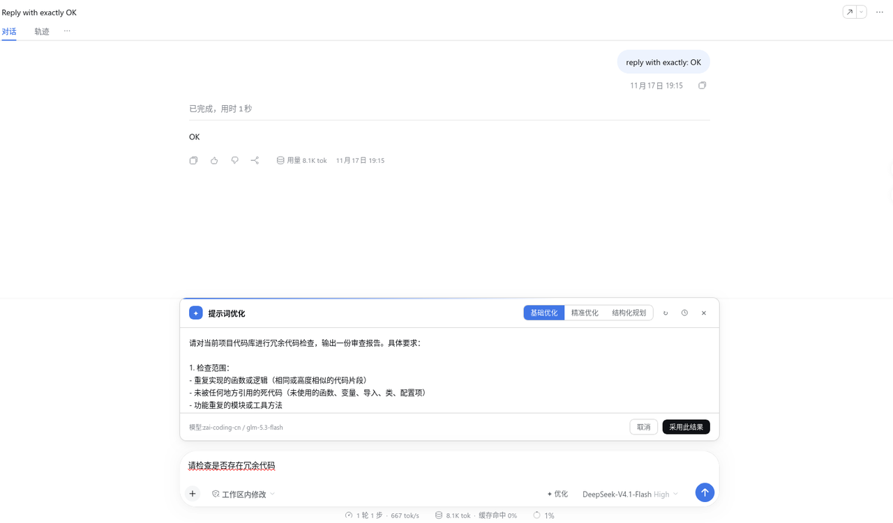

# dsh-prompt-optimizer

> 本插件的每一行代码（Host 路由、React 组件、优化模板、设置页、这份 README）均由 AI 生成。

一个 [DeepSeek Harness (DSH)](https://www.npmjs.com/package/@deepseek-ai/dsh) 插件：在输入框旁加一颗 **✦ 优化** 按钮，一键把你的提示词草稿改写成更清晰的版本。优化在 Host 侧以一次性模型调用完成——**不进入会话、不消耗会话轮次、不污染聊天记录**。

> [!IMPORTANT]
> **本插件仅支持 Web UI**（`dsh web`）。桌面端尚未适配。



*图：输入框工具行的「✦ 优化」按钮与优化结果卡片——模式切换、重新优化、采用此结果，一站式完成。*

## ✨ 功能

- **三种优化模式**：基础优化（消除模糊表达）/ 精准优化（参数、标准与边界具体化）/ 结构化规划（角色-步骤-输出式提示词）
- **三档优化强度**：精炼 / 均衡 / 深入（控制输出风格与采样温度）
- **结果卡片**：即时切换模式重跑、编辑结果、一键「采用此结果」写回草稿
- **设置页**：默认模式、强度、自定义提示词模板、模型路由（跟随 DSH 默认模型，或从已配置的模型目录中选择），保存即时生效
- **安全设计**：草稿以 JSON 证据形式注入，防提示词注入；占位符 `{{variable}}` 与关键细节强制保留；`po-optimize` 内部命令通道

## 📦 安装


```bash
git clone https://github.com/OneSakana/dsh-prompt-optimizer.git
cd dsh-prompt-optimizer && pnpm install
```

然后任选一种方式安装：

**方式 A · 终端（推荐，纯人工操作）**

```bash
dsh plugin --profile <profile> add "$(pwd)"
```

安装后重启你的 DSH 服务使插件生效

**方式 B · 对话式（让 DSH 助手代劳）**

在 DSH 对话里说一句“把 <本目录绝对路径> 安装为插件”，助手会调用 `install_bundle` 完成安装并热加载（热加载无需重启）。

刷新页面即可使用。

## 🗑️ 卸载

与安装方式对应，任选其一：

**方式 A · 终端**

```bash
dsh plugin --profile <profile> remove dsh-prompt-optimizer
```

**方式 B · 对话式**

在 DSH 对话里说一句“卸载 dsh-prompt-optimizer 插件”，助手会调用 `remove_bundle` 完成卸载。

卸载后,重启 DSH 服务后刷新页面

## 🚀 使用

1. 在输入框写下草稿；
2. 点 **✦ 优化**，稍等片刻；
3. 在卡片里换模式、改文本，满意后点「采用此结果」——草稿已被替换，原文仍保留在原地。

设置入口在 **插件详情页** 内（已安装插件列表 → dsh-prompt-optimizer）。

## ⚙️ 架构速览

- **Host 半** `index.js`：在真实 webServer 上注册 `/api/prompt-optimizer`（优化与元数据）、`/settings`（读写，revision 校验）、`/models`(模型目录) 路由，均经 `connection.requestRejection` 准入；导出 schemastery `Config` schema（全字段 volatile，保存即热更新）。
- **Client 半** `client.js`：`conversation.input.right` 按钮、`conversation.input.dock` 结果卡片、插件详情页设置卡片与 `main` 设置页。
- 设置通过 DSH `settings` 服务的 `prompt-optimizer` 命名空间持久化，重启保留。

## 🙏 致谢

优化模式与设置项的组织方式参考了 [linshenkx/prompt-optimizer](https://github.com/linshenkx/prompt-optimizer)（AGPL-3.0）的设计思路。本项目所有代码均为AI实现，未复制其代码。

## 📄 许可证

[MIT](./LICENSE)
